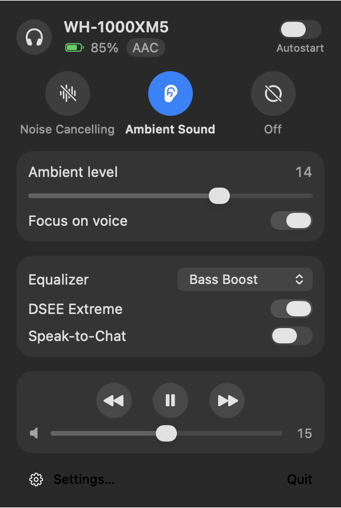

# SonyMenu

Menu bar app for Sony WH-1000XM5 headphones on macOS. It does what Sony's phone app does, plus custom gestures, with no Sony app and no internet.



## Features

- Battery, codec, Noise Cancelling / Ambient / Off, ambient level, voice focus
- Equalizer presets and custom EQ with Clear Bass, DSEE Extreme
- Speak-to-Chat, pause when taken off, auto power off, multipoint, touch panel on/off
- Playback controls and headphone volume
- Gesture remapping: give any touch or the left button a Mac action (next/previous, pause, a keyboard shortcut, an app, dictation…)

## Install

Requires macOS 26+ and the Xcode command line tools.

```bash
git clone https://github.com/VohidovTohirjon/SonyMenu.git
cd SonyMenu
./build.sh --install
```

Gesture remapping needs Accessibility access: allow SonyMenu when macOS asks. After a rebuild, run `tccutil reset Accessibility local.sonymenu` and allow it again.

## Notes

Tested on WH-1000XM5 (firmware 2.3.1). The protocol details are in [docs/PROTOCOL.md](docs/PROTOCOL.md). Unofficial; not affiliated with Sony.
